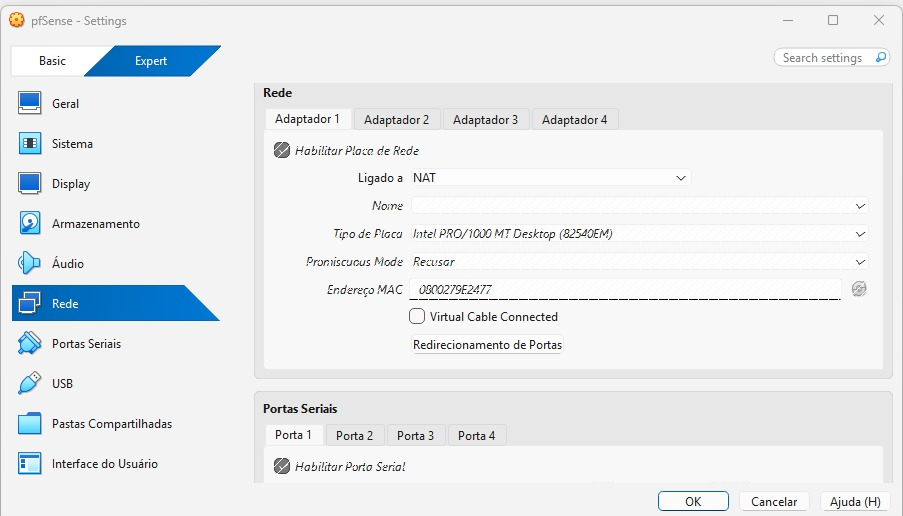
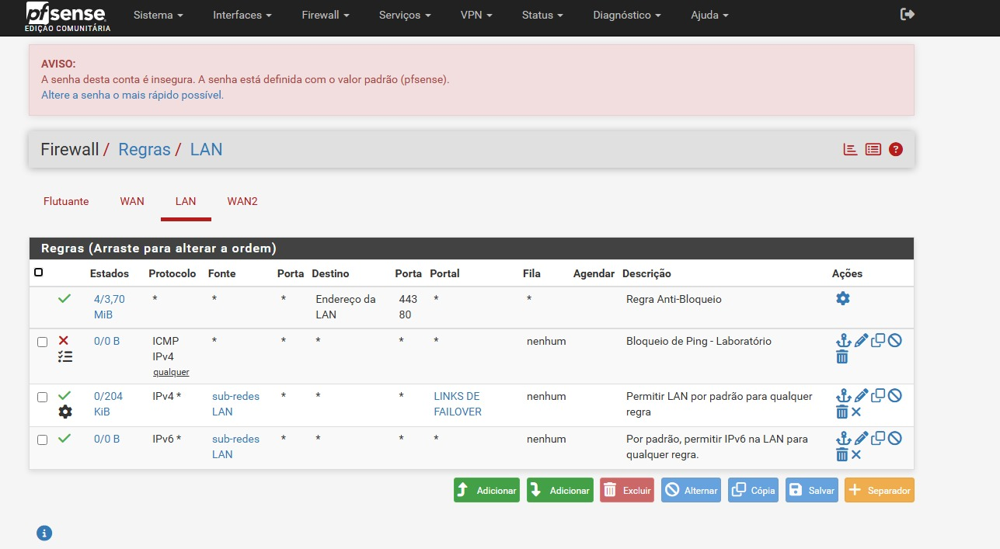
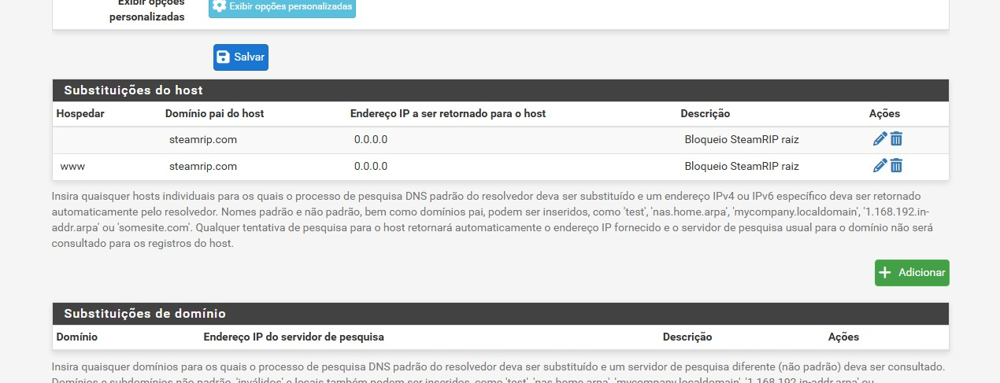
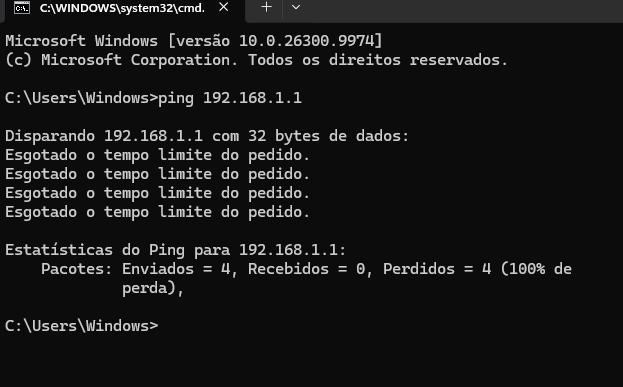
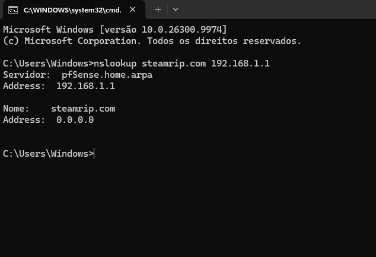
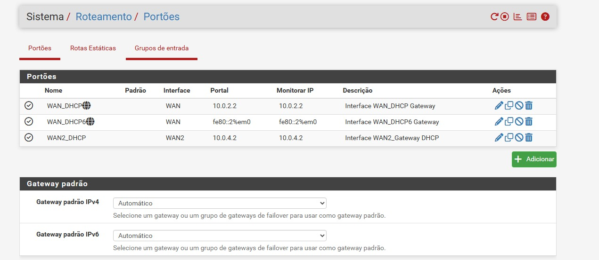
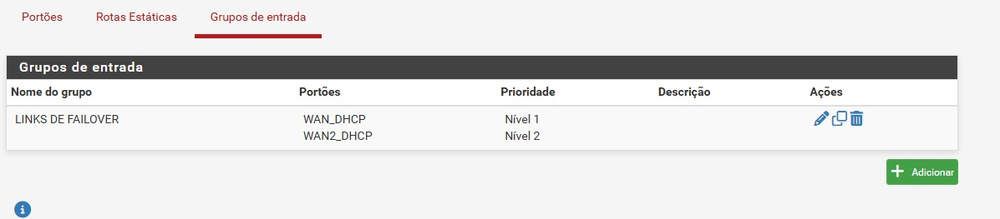
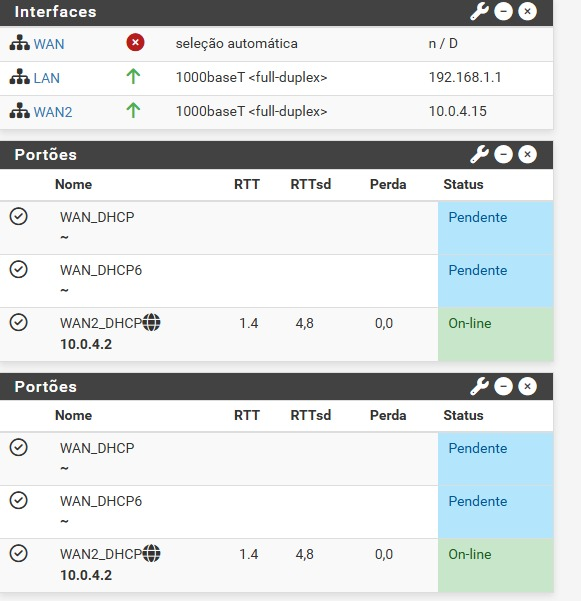
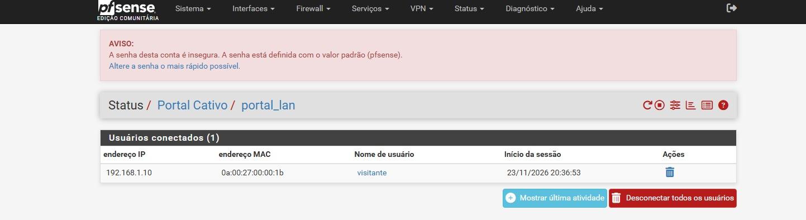

# 🛡️ Laboratório Corporativo de Redes e Segurança com pfSense

Implementação prática de segurança de borda, filtragem de tráfego, alta disponibilidade (Multi-WAN Failover) e controle de acesso de usuários (Captive Portal) utilizando **pfSense Community Edition** em ambiente virtualizado.

---

## 🏗️ 1. Arquitetura e Topologia do Ambiente

O laboratório foi estruturado no **Oracle VM VirtualBox** simulando uma infraestrutura corporativa com redundância de internet e rede interna isolada:

| Interface | Modo de Rede (VirtualBox) | Endereçamento / Função |
| :--- | :--- | :--- |
| **WAN** | NAT | Link de Internet Principal (`WAN_DHCP` — Nível 1) |
| **WAN2** | NAT Network | Link de Internet Secundário / Backup (`WAN2_DHCP` — Nível 2) |
| **LAN** | Host-Only Adapter | Rede Corporativa Interna (`192.168.1.0/24` — Gateway `192.168.1.1`) |

* **Configuração de Interfaces no VirtualBox:**
  

---

## 🔒 2. Módulo 1: Regras de Firewall e Filtragem DNS

* **Regras na Interface LAN (Bloqueio ICMP e Roteamento Failover):**
  
* **Bloqueio de Domínios via DNS Resolver (Sinkhole `steamrip.com` → `0.0.0.0`):**
  
* **Validação de Bloqueio ICMP (`ping 192.168.1.1` com 100% de perda):**
  
* **Validação de Bloqueio DNS (`nslookup steamrip.com` retornando `0.0.0.0`):**
  

---

## 🔄 3. Módulo 2: Alta Disponibilidade — Multi-WAN (Failover)

* **Configuração dos Gateways (`WAN_DHCP` e `WAN2_DHCP`):**
  
* **Criação do Grupo de Redundância (`LINKS DE FAILOVER` — Nível 1 e Nível 2):**
  
* **Teste Real de Queda de Link (`WAN` offline e `WAN2` assumindo o tráfego):**
  

---

## 🔑 4. Módulo 3: Controle de Acesso — Captive Portal

* **Auditoria de Sessão Ativa na Zona `portal_lan` (Usuário `visitante`):**
  

---

## 🛠️ Competências Técnicas Aplicadas
* Administração de Firewalls (*Stateful Packet Inspection*) e precedência de regras.
* Filtragem de conteúdo via DNS (*Sinkholing* com Unbound DNS).
* Redundância de links ISP (Multi-WAN Failover) e monitoramento de perda de pacotes.
* Controle de acesso à rede (NAC / Captive Portal) com banco de usuários locais.
